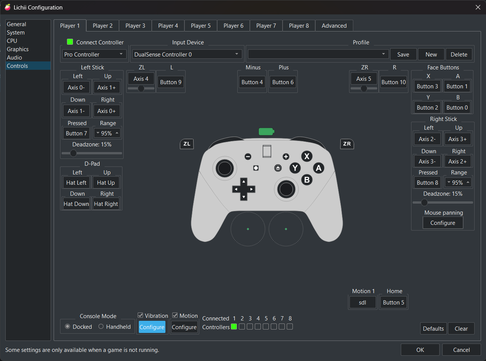
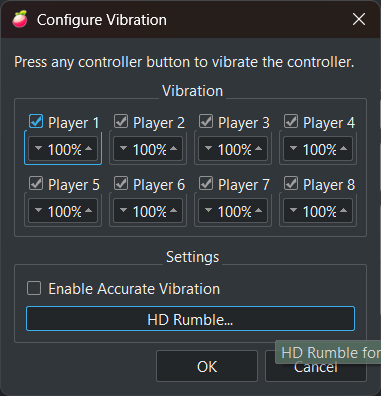
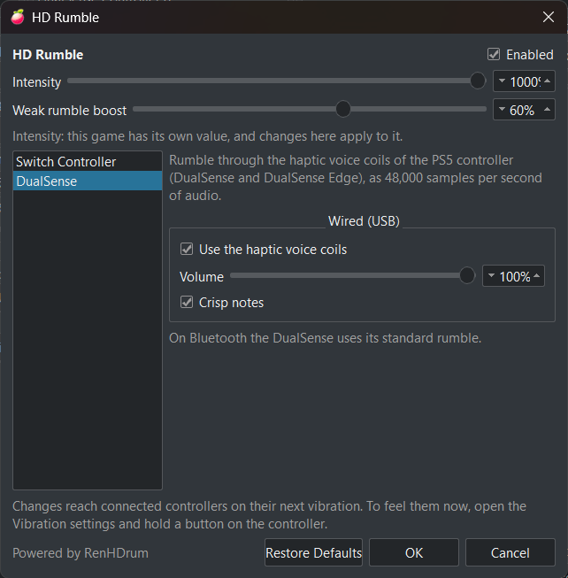

# renhdrum-eden

HD Rumble and DualSense haptics for **Eden-based Switch emulators** (Eden, Eglantine, Lichii and their forks), powered by [RenHDrum](https://github.com/trzz1214/RenHDrum).

This repository is a **patch series**. You apply it to an emulator's source tree and build the emulator yourself. It contains no emulator binaries, no keys, no firmware and no game data.

| Patch | What it adds |
|---|---|
| `0001` | Vibration routed through RenHDrum: HD Rumble packets for Switch controllers, haptics for a DualSense, wired or on Bluetooth, and rumble for Xbox-style controllers of any brand. Includes an **HD Rumble** settings dialog with a per-game **Intensity** and **Weak rumble boost**. |
| `0002` | `EDEN_HDRUMBLE_TRACE=1`: writes every vibration value a game sends to a CSV, for studying a game's HD Rumble. Optional; it depends on HID command 214, which Eglantine and Lichii have. |

The same change is proposed upstream: see [Upstream status](#upstream-status).

---

## What it does

Switch and Switch 2 games describe vibration as two bands (low and high), each with an amplitude and a frequency, sent every few milliseconds. Most emulators collapse that into a plain "motor strength" rumble. With this series, the emulator hands the full signal to RenHDrum, which plays it on the controller:

| Controller | Connection | What you get |
|---|---|---|
| Nintendo Switch Pro Controller, Joy-Con | USB or Bluetooth | Real HD Rumble packets: 5 ms AM/FM envelope, frequency changes inside a packet, "crisp notes" (stronger attack, softer sustain), Bluetooth pacing that keeps input lag down |
| Sony DualSense / DualSense Edge | USB | The vibration played as 4-channel 48 kHz audio on the controller's haptic voice coils, the most detailed rumble available on PC |
| Sony DualSense / DualSense Edge | Bluetooth | The same voice-coil haptics, sent as HID output report `0x32` every 10.667 ms while the game vibrates. Needs RenHDrum 0.2.1 or newer; an older DLL keeps the standard rumble. |
| Xbox One / Series / 360 style, any brand | USB, Bluetooth or receiver | **RenHDrum** mode: RenHDrum's four-motor converter, tuned on the Xbox One S. **Direct** mode: full motor power for pads with weaker motors, with detail on the main motor, hit accents and, on pads with trigger motors, the fine vibration on LT/RT. Trigger motors only where SDL exposes them: official pads through Windows' Xbox driver, with the emulator's *Enable XInput 8 player support* on. Needs RenHDrum 0.2.0 or newer. |
| Other controllers | any | Standard rumble (unchanged) |

RenHDrum is a separate library, `renhdrum.dll`, that the emulator **loads at runtime**. If it is not next to the emulator, nothing changes: every controller keeps the standard rumble.

Switch 2 games send their vibration through HID command 214 (`SendNx2VibrationValues`), which Eglantine and Lichii implement, so their HD Rumble reaches RenHDrum too.

For how HD Rumble works and how RenHDrum reproduces it, read the RenHDrum author's [research notebook](https://ryuhdr.threedola.workers.dev) and the [research notes in the RenHDrum repository](https://github.com/trzz1214/RenHDrum/tree/main/docs/research).

---

## Compatibility

Weekly CI checks that the series still applies to these trees:

| Tree | Branch | Applies | Built |
|---|---|---|---|
| [Frizti/Lichii](https://github.com/Frizti/Lichii) | `frizti-v1` tag | ✅ | |
| [Frizti/Lichii](https://github.com/Frizti/Lichii) | `frizti-v2` tag | ✅ | |
| [Frizti/Lichii](https://github.com/Frizti/Lichii) | `nx2` | ✅ | ✅ Windows x64 (MSVC) |
| [zortos293/Lichii](https://github.com/zortos293/Lichii) | `nx2` | ✅ | ✅ Windows x64 (MSVC), Linux (GCC 13, `-Werror`, tests) |
| [K-code-AI/Greenhat-Lichii](https://github.com/K-code-AI/Greenhat-Lichii) | `build-4` release | ✅ | ✅ Windows x64 (MSVC), played |
| [Djihads80/Eglantine](https://github.com/Djihads80/Eglantine) | `nx2` | ✅ | |

[](https://github.com/samaBR85/renhdrum-eden/actions/workflows/check-patches.yml)

It was played on Windows with a wired DualSense Edge, in Ocarina of Time and Donkey Kong Bananza, on Lichii `frizti-v1` and `frizti-v2`. Those play tests used an earlier layout of the same code (inline in the SDL driver). The current layout was then run on `zortos293/Lichii nx2`: the downloaded `renhdrum.dll` loaded, the DualSense was picked up, its haptics audio device opened, and the emulator closed cleanly. The current layout is also played day to day on `K-code-AI/Lichii build-4` with RenHDrum v0.2.1. DualSense haptics over Bluetooth were played on the same build and feel the same as wired. No Switch Pro Controller was available for testing.

Upstream [Eden](https://git.eden-emu.dev/eden-emu/eden) and other forks share the same input code and should take the series with little or no change, but have not been tried. If you port it to another fork, a pull request adding it to this table is welcome.

---

## Applying the patches

```bash
# in your emulator checkout
git am --3way /path/to/renhdrum-eden/patches/*.patch
```

To leave the trace out, apply only `0001`. If a patch does not apply, `git am --3way` leaves conflict markers. Fix them, then `git add` the files and run `git am --continue`.

---

## Building

Use the emulator's normal build (its `docs/Build.md`). No Rust and no extra library are needed to compile: RenHDrum's C header comes with the patch (`externals/renhdrum/renhdrum.h`, v0.2.1).

Three CMake options control it:

| Option | Default | What it does |
|---|---|---|
| `ENABLE_RENHDRUM` | ON | Builds the RenHDrum support. Harmless without the library. |
| `RENHDRUM_DOWNLOAD` | OFF | Windows: downloads the official [RenHDrum v0.2.1](https://github.com/trzz1214/RenHDrum/releases/tag/v0.2.1) `renhdrum.dll`, checks its SHA-256, and copies it next to the emulator executable. |
| `RENHDRUM_SDL_PATCHES` | OFF | Builds SDL3 3.4.8 from source with [RenHDrum's two SDL3 patches](https://github.com/trzz1214/RenHDrum/tree/main/integrations/sdl3/sdl3-patches) (a separate `sdl3-hdrumble` package). They add "no-queue" and "write after input" modes for Switch controllers. Without them RenHDrum paces queued writes by its own clock. They are opt-in because they also change SDL's default Switch rumble refresh. |

For the full experience on Windows, add `-DRENHDRUM_DOWNLOAD=ON -DRENHDRUM_SDL_PATCHES=ON`. The configure line used for the tested build (Qt 6.8.3 `msvc2022_64`, Ninja, Visual Studio 2022 Build Tools environment loaded):

```bat
cmake -S . -B build -G Ninja -DCMAKE_BUILD_TYPE=Release ^
  -DYUZU_TESTS=OFF -DYUZU_CMD=ON -DYUZU_ROOM=OFF -DYUZU_USE_BUNDLED_QT=OFF ^
  -DENABLE_RENHDRUM=ON -DRENHDRUM_DOWNLOAD=ON -DRENHDRUM_SDL_PATCHES=ON ^
  -DVulkanHeaders_FORCE_BUNDLED=ON -DVulkanUtilityLibraries_FORCE_BUNDLED=ON ^
  -DCMAKE_PREFIX_PATH=C:/Qt/6.8.3/msvc2022_64
cmake --build build
```

On Linux and macOS, build `librenhdrum.so` / `librenhdrum.dylib` from [RenHDrum](https://github.com/trzz1214/RenHDrum) (`cargo build --release`) and put it where the dynamic loader finds it.

Build tips:

- **CMake from Visual Studio.** If another CMake comes first on your `PATH` (MSYS2 or devkitPro, for example), call Visual Studio's own `cmake.exe` instead. A foreign CMake fails at "Detecting C compiler ABI info".
- **Shader compiler.** `glslangValidator` must be on `PATH`. The [glslang releases](https://github.com/KhronosGroup/glslang/releases) ship it as `glslang.exe`; copy it to `glslangValidator.exe`.
- **Packaging.** When you package the emulator, ship `renhdrum.dll` next to it.

---

## Using it

Nothing to switch on: a supported controller uses RenHDrum as soon as it connects. The emulator log confirms it:

```
RenHDrum: loaded renhdrum.dll
RenHDrum: DualSense haptics for 054C:0DF2
RenHDrum: DualSense haptics on "Speakers (DualSense Edge Wireless Controller)"
```

or, for a DualSense on Bluetooth:

```
RenHDrum: DualSense haptics over Bluetooth (report 0x32)
```

or, for a Switch controller:

```
RenHDrum: HD Rumble for 057E:2009 (Bluetooth: false)
RenHDrum HD Rumble wired: 15 ms, no-queue writes, 5 ms envelope, crisp notes
```

Without the library, the log says `RenHDrum: renhdrum.dll not found, using the standard rumble`, and so does the HD Rumble dialog.

### The HD Rumble dialog

Open it from **Emulation > Configure > Controls > Vibration: Configure > HD Rumble...**:

1. In **Controls**, click **Configure** under **Vibration**, at the bottom of the player page.

   

2. In **Configure Vibration**, click **HD Rumble...**. Keep the player's strength at 100 %. Turning on **Enable Accurate Vibration** is recommended: without it, the emulator drops vibrations that come less than 15 ms apart before RenHDrum sees them.

   

3. The HD Rumble dialog, on the Switch Controller page, with **Intensity** and **Weak rumble boost** at 1000 % and 60 %, the values that suit Ocarina of Time.

   

What each setting does:

- **Enabled** turns RenHDrum on or off for every controller. Off means the emulator's standard rumble.
- **Intensity** and **Weak rumble boost** apply to all controllers. See below.
- **Switch Controller**
  - **Wired:** packet interval (15 ms is the console's rate), 5 ms envelope, frequency changes inside a packet, crisp notes.
  - **Bluetooth:** level 1 Stable / 2 Balanced / 3 Quality (60 / 45 / 35 ms), send right after an input report, 5 ms envelope while the link is idle, crisp notes.
- **DualSense:** use the voice coils, volume, crisp notes.
- **Xbox:** on/off, mode (RenHDrum or Direct), motor strength, and in Direct mode detail on main motor, hit accents and trigger rumble (disabled, with a note, on a controller without trigger motors). Starting points: for a third-party pad on a 2.4 GHz receiver (XInput, grip motors only; tested with a GameSir G7 Pro), Direct with motor strength around 25%; for an official Xbox controller over USB (tested with an Xbox Series controller), Direct with motor strength 20%, detail 50%, hit accents 50% and trigger rumble 20%. With an official controller whose trigger motors are out of reach, the page offers a one-click *Turn it on* for *Enable XInput 8 player support*.
- The dialog opens on the page of the controller in use, marked "(connected)".
- **Restore Defaults** goes back to RenHDrum's recommended mode.

Changes reach connected controllers on their next vibration, without restarting the game. To feel them right away, hold a controller button in the Vibration dialog.

### Per-game intensity and weak rumble boost

| Setting | Range | What it does |
|---|---|---|
| `hd_rumble_gain` | 25-1000 % | Multiplies the amplitudes the game sends. |
| `hd_rumble_low_boost` | 0-100 % | A power curve after the gain: lifts weak vibrations more than strong ones. Exponent 1.0 at 0 %, 0.4 at 100 %. Below 0.02 the curve turns quadratic, so the near-silent values a game sends between hits do not become a constant buzz. |

Both are per-game settings. The global value stays at 100 % / 0 %, and a game gets its own values in its custom config. On Windows that file is `%APPDATA%\eden\config\custom\<title id>.ini`, under `[Controls]`:

```ini
[Controls]
hd_rumble_gain\use_global=false
hd_rumble_gain\default=false
hd_rumble_gain=1000
hd_rumble_low_boost\use_global=false
hd_rumble_low_boost\default=false
hd_rumble_low_boost=60
```

With the game running, the HD Rumble dialog shows that game's values. Changes there apply right away, but write the final values into the file above to keep them.

An emulator **without** this series drops these keys when it saves that game's properties: Eden-based emulators share `%APPDATA%\eden`. Avoid saving the game's properties in one, or add the keys back afterwards.

### Vibration trace (patch 0002)

Set `EDEN_HDRUMBLE_TRACE=1`, either in the environment or in `nx2_switches.txt` next to the emulator. Every change of a vibration value sent through command 214 is then written to `<log dir>/hdrumble_trace.csv`: time, mode, controller, low/high amplitude, low/high frequency. The file is created on the first vibration and replaced each session. It stops after 3 million lines.

---

## Findings: Ocarina of Time

Recorded with the trace on Lichii with a wired DualSense Edge, and weighted by how long each value held. The files and the full table are in [`research/traces`](research/traces/):

| | Ocarina of Time (Switch 2, `0400486024DEC000`), two sessions | Donkey Kong Bananza |
|---|---|---|
| Command / mode | 214, Mode 2 | 214, Mode 2 |
| Median amplitude while vibrating | 0.001 / 0.006 | 0.014 |
| 99th percentile | 0.096 / 0.111 | 0.234 |
| Peak | 0.096 / 0.178 | 0.401 |
| Vibrating time at 0.1 or more | 0 % / 1.5 % | 8.3 % |
| Frequency range | 42-341 Hz | 30-504 Hz |

Ocarina of Time sends weaker amplitudes than Donkey Kong Bananza at every level, and rarely goes above 0.1, yet it rumbles strongly on a Switch 2. Played as sent, it feels as weak as an emulator's default rumble. **Intensity 1000 % with weak rumble boost 60 %** came close to the console.

This fits the "equalization between hardware generations" that the RenHDrum author found in Nintendo patent filings (see [research/11](https://github.com/trzz1214/RenHDrum/blob/main/docs/research/11-switch2-hd-rumble.md)): the console seems to scale Mode 2 amplitudes for its own actuators. With traces from more games, it might become a curve applied automatically rather than per game.

---

## Upstream status

| Where | What |
|---|---|
| [zortos293/Lichii#213](https://github.com/zortos293/Lichii/pull/213) | This change (patch `0001`), proposed to Lichii |
| [Frizti/Lichii#4](https://github.com/Frizti/Lichii/pull/4) | The same change, proposed to Frizti's Lichii |
| [K-code-AI/Greenhat-Lichii#8](https://github.com/K-code-AI/Greenhat-Lichii/pull/8), [#10](https://github.com/K-code-AI/Greenhat-Lichii/pull/10) | **Merged** into K-code's Greenhat-Lichii (formerly K-code-AI/Lichii): HD Rumble, DualSense wired and Bluetooth, and Xbox support ([#18](https://github.com/K-code-AI/Greenhat-Lichii/pull/18)). Trigger rumble proposed in [#20](https://github.com/K-code-AI/Greenhat-Lichii/pull/20) |
| [trzz1214/RenHDrum#1](https://github.com/trzz1214/RenHDrum/pull/1) | A link to this series and the Ocarina of Time findings: **merged** as [`integrations/eden-forks`](https://github.com/trzz1214/RenHDrum/tree/main/integrations/eden-forks) |

---

## Known limitations

- **Command 213 is a stub** in Eglantine and Lichii. A game that vibrates only through it stays silent; this series does not change that.
- **Xbox controllers:** trigger motors need *Enable XInput 8 player support* (raw input) on Windows; third-party XInput pads and receivers drive only the grip motors. Tested with a GameSir G7 Pro on its receiver and an Xbox Series controller over USB. With raw input on, an earlier version could hang at start or close; the series now avoids SDL calls under the SDL driver's joystick map lock. That option disables the web applet; without it, only the grip motors play.
- **Switch 2 Pro Controller and Joy-Con 2:** not supported by RenHDrum yet.

---

## Credits

This series is a port and extension of other people's work:

- **[RenHDrum](https://github.com/trzz1214/RenHDrum)** by **Three-Dola** ([trzz1214](https://github.com/trzz1214)): the HD Rumble and DualSense haptics engine, the [SDL3 HD Rumble patches](https://github.com/trzz1214/RenHDrum/tree/main/integrations/sdl3/sdl3-patches), and the [Brontide reference patches](https://github.com/trzz1214/RenHDrum/tree/main/integrations/brontide) that patch `0001` started from, including the DualSense Bluetooth haptics of patch 0011. Their [research notebook](https://ryuhdr.threedola.workers.dev) explains the whole subject. RenHDrum in turn credits dekuNukem, the Switchbrew wiki contributors, felipearmat, rei-github, ClearlyClaire, CTCaer, Nielk1, egormanga, the SDL team and others: see [its credits](https://github.com/trzz1214/RenHDrum#research-credits--acknowledgments) and [NOTICE](https://github.com/trzz1214/RenHDrum/blob/main/NOTICE).
- **neo Luigi**, for HID command 214 (`SendVibrationValuesInMode`) dispatching in [Eglantine PR #155](https://github.com/eglantine-emu/eglantine/pull/155). That is what carries Switch 2 vibration to the input layer.
- **[Eden](https://git.eden-emu.dev/eden-emu/eden)** and the yuzu project, the emulator these trees come from.
- **[Eglantine](https://github.com/Djihads80/Eglantine)** (Djihads80), the Switch 2 Eden fork; **[Lichii](https://github.com/zortos293/Lichii)** (zortos293); and **[Frizti/Lichii](https://github.com/Frizti/Lichii)** (Frizti), the tree this series was built and tested on.
- **[PokeDinner](https://github.com/Franseven/PokeDinner)** by Franseven, the base of Brontide-NS2, RenHDrum's own Switch 2 testbed.
- **[SDL](https://github.com/libsdl-org/SDL)** (Sam Lantinga, Valve and contributors).
- **[CodeRabbit](https://coderabbit.ai)**'s review of the Lichii pull request found the Joy-Con driver conflict and the lock-ordering problems that this version fixes.

The port to Lichii, the runtime-loaded layout, the HD Rumble dialog, the per-game intensity and boost, the trace and the Ocarina of Time findings are by **[samaBR85](https://github.com/samaBR85)**, written with [Claude Code](https://claude.com/claude-code).

---

## License

- **The patches** modify GPL-licensed emulator code and include code ported from RenHDrum's Brontide patches (GPL-3.0-or-later). They are licensed under the **GNU General Public License v3.0 or later**; see [LICENSE](LICENSE).
- **RenHDrum** itself is MIT OR Apache-2.0, including the header that patch `0001` adds as `externals/renhdrum/renhdrum.h`. Its **SDL3 patches**, which patch `0001` adds under `.patch/sdl3-hdrumble/`, are under the zlib license. Both keep their own licenses, recorded in the patch's `.reuse/dep5` entries: see the [RenHDrum repository](https://github.com/trzz1214/RenHDrum).

Nintendo Switch, Joy-Con and Pro Controller are trademarks of Nintendo. PlayStation and DualSense are trademarks of Sony Interactive Entertainment. This project is not affiliated with Nintendo, Sony or the RenHDrum author. Bring your own legally dumped games and keys.
